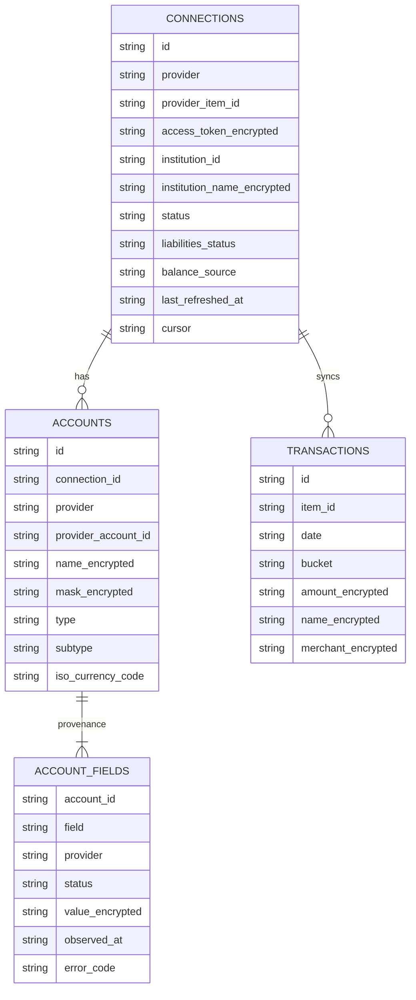
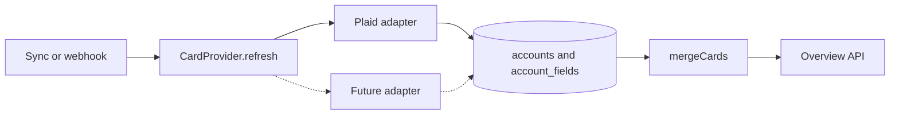
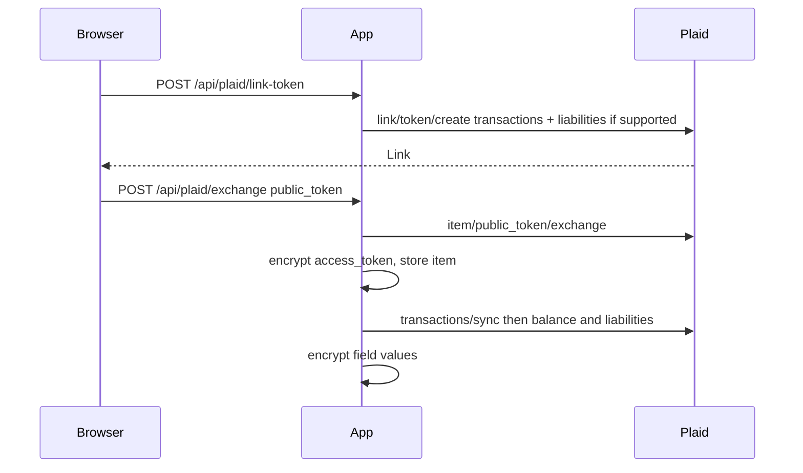
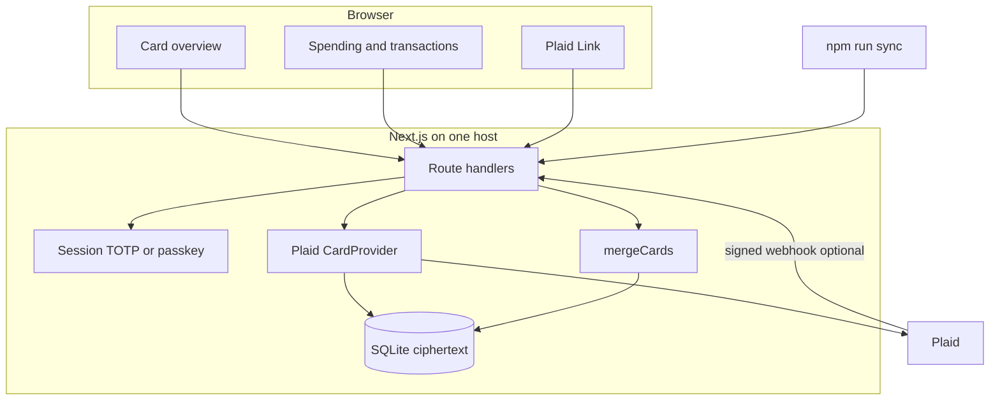

# AmexLens architecture

> **Salvaged draft (Oct 30, 2026).** Written by a Cursor builder agent that crashed before pushing any code. Vendor facts, prices, dates and the Plaid coverage-file flags are **unverified**: re-check against each vendor's current docs before relying on them. Wherever this file says "this build", "already in the app", or names files such as `0002_card_liabilities.sql`, `lib/webhooks.ts`, or `scripts/verify-sandbox.mjs`, read it as **the design target, not existing code**. None of that code is on `main`. See `HANDOVER.md`.


Single-user credit-card overview on top of the existing Next.js 14 spending dashboard. Transactions, categorization, and the monthly trend stay. The home screen becomes the card overview.

Provider research and the primary/fallback decision live in [data-providers.md](./data-providers.md). This file is the system design. A separate security review may land in `docs/SECURITY.md`. The controls in the Security section below are what the code implements. They do not wait on that review.

## 1. Providers

**Primary: Plaid.** Transactions for the spending pages. Liabilities for statement balance, minimum payment, due date, last payment, APR, and overdue. Balance (`/accounts/balance/get`) for current balance, available credit, and limit, with `/accounts/get` as a cached fallback. Sandbox works with `user_good` / `pass_good`. An individual developer can use Plaid Trial (US/CA, signups on or after 15 April 2026, up to 10 production Items, includes Liabilities) before paying for full Production.

**Fallback, interface only in this build: Yodlee.** Same liability fields, Canada listed in FastLink, enterprise contract. The merge function already prefers a present value from a lower-priority provider when Plaid's status is `not_supplied`, `not_supported`, `consent_required`, or `error`. No Yodlee calls are made until credentials exist. Wiring a client that cannot be sandbox-tested would be a stub, so it is not shipped.

**Explicitly not the fallback for these fields: Flinks.** Better Canadian login coverage, and it returns current / available / limit, but it does not publish the liability fields. MX has a complete account schema and a thin public Canadian institution list. Finicity's schema is excellent and the product is not offered in Canada. Akoya is a US FDX network. Wealthica is investments. Inverite is lender verification. Detail and the institution table are in the provider doc.

Plaid institution flags are eligibility, not a promise that APR or the due date is non-null. The overview prints the status of each field.

## 2. Data model

Logical model. SQLite tables are the physical model. `plaid_items` stays the connection row because `transactions.item_id` already references `plaid_items.item_id`. Renaming it would be a risky migration for no query benefit. `provider` on that row is `plaid` today and is the discriminator a second provider would use.



Connections are Plaid Items. Accounts are provider accounts of type `credit` (credit cards and PayPal credit, which Plaid returns on the liabilities `credit` array). Loans, mortgages, and deposit accounts are not cards. Their transactions still sync.

Each card field is its own observation:

| Field key | Meaning |
|---|---|
| `current_balance` | Amount owed. Positive means the cardholder owes it (Plaid's credit-account sign). |
| `available_credit` | Issuer available credit. Not computed from limit minus balance. |
| `credit_limit` | Issuer limit. |
| `statement_balance` | Last statement balance. "Due this cycle" totals use this, not the minimum. |
| `minimum_payment` | Minimum due. |
| `next_payment_due_date` | `YYYY-MM-DD`. |
| `last_payment_amount` | Last payment amount. |
| `last_payment_date` | `YYYY-MM-DD`. |
| `is_overdue` | Boolean from the provider. `false` is a real value, not a missing one. |
| `apr` | Array of `{ apr_percentage, apr_type, balance_subject_to_apr, interest_charge_amount }`. |

`status` is one of:

- `present` — value is from the provider
- `not_supplied` — the call succeeded and this field was null
- `not_supported` — the institution or product does not offer it
- `consent_required` — Plaid needs an update-mode Link session
- `error` — the call failed; `error_code` is a provider code, not a message body

`provider` and `observed_at` are the provenance. The API returns them. The UI uses them for the gap text ("Not supplied by Plaid", "Plaid does not support this field at this institution", "Reconnect Plaid to grant liabilities access").

There is no manual-entry column. Utilization is derived at read time and labeled computed.

Transactions keep `date`, `bucket`, `item_id`, and `pending` in the clear so the existing filters and charts can use indexes. Amount, merchant, name, logo, Plaid category, and account id are encrypted. See Security.

Physical tables added in `lib/db/migrations/0002_card_liabilities.sql` and `0003_auth.sql`:

- `accounts`
- `account_fields`
- extra columns on `plaid_items` (`provider`, `status`, product lists, `liabilities_status`, `balance_source`, `last_refreshed_at`, `last_error`)
- `auth_state` (single row: TOTP secret, backup-code hashes, passkey)

## 3. Provider adapter and merge



```ts
interface CardProvider {
  id: string;
  refresh(connection: ConnectionSecrets): Promise<ProviderRefresh>;
}

interface ProviderRefresh {
  cards: ProviderCard[];          // empty if the account list could not be fetched
  accounts_fetched: boolean;      // false means do not delete stored cards
  balance_source: "realtime" | "cached" | "error";
  liabilities_status: "ok" | "not_supported" | "consent_required" | "pending" | "error";
  error_code: string | null;
}
```

The Plaid adapter:

1. Calls `/accounts/balance/get`. On failure it calls `/accounts/get` and sets `balance_source` to `cached`.
2. Calls `/liabilities/get`. Maps `error_code` to `liabilities_status`. Does not throw out of the transaction sync.
3. Keeps accounts with `type === "credit"`.
4. Emits one observation per field. Nulls become `not_supplied` when the call worked, or the call's failure status when it did not.

Merge runs on read, not on write. Stored rows stay per provider account. `mergeCards` groups by a reconciliation key:

`normalize(institution name) + last 4 of mask + currency`

If both institution and mask are missing, the key is the provider account id so unrelated cards are not glued together.

For each field in a group, a `present` value wins. Among present values, provider priority wins (`plaid`, then `yodlee`, then `mx`, then `flinks`). If nobody has a present value, the highest-priority observation is kept so the UI can show why. A second provider's `not_supported` must not hide Plaid's `not_supplied`, and Plaid's `not_supported` must not hide another provider's real number. The priority rule does that.

The registry returns the Plaid adapter only. A later adapter is appended when its env vars are set. It writes its own `accounts` / `account_fields` rows. The read path merges them.

## 4. Connection, tokens, refresh



New items: `products: ["transactions"]`, `required_if_supported_products: ["liabilities"]`, country codes from `PLAID_COUNTRY_CODES` (default `US,CA`), `redirect_uri` only if `PLAID_REDIRECT_URI` is set. Balance is not placed in `products`. Plaid rejects that. Auth, Identity, Investments, and Statements are not requested.

Existing items that predate Liabilities: Settings calls link-token with `item_id`. The server loads the stored access token and opens Link in update mode with `additional_consented_products: ["liabilities"]` and no `products` array. On success the browser calls `/api/plaid/consent` with the item id. The client never sends an access token. The server refreshes that item.

OAuth (US institutions; whether a given Canadian institution uses OAuth is probed, not assumed, see data-providers.md): the link token is kept in `sessionStorage` under `amexlens_plaid_link` so `/plaid/oauth` can resume with `receivedRedirectUri`. The token is cleared after success. It is not put in the query string.

Re-auth: Plaid error `ITEM_LOGIN_REQUIRED`, and the webhook codes `PENDING_EXPIRATION` and `USER_PERMISSION_REVOKED`, set `plaid_items.status`. Settings shows that status. Update mode without extra products is the repair path. The same button requests liabilities consent when status is `consent_required`.

Token storage: the Plaid access token is AES-256-GCM ciphertext in `plaid_items.access_token`. The database layer decrypts it inside the server process. It is not returned by any API. Public tokens and link tokens are not stored.

Webhooks versus cron:

- Default is cron. A homelab or Tailscale deploy often has no public HTTPS endpoint. `npm run sync` calls `POST /api/plaid/sync`.
- `POST /api/plaid/webhook` exists for when `PLAID_WEBHOOK_URL` is set on the link token. It verifies the `Plaid-Verification` JWT (ES256, key from `/webhook_verification_key/get`, `iat` within 5 minutes, SHA-256 of the raw body compared in constant time to `request_body_sha256`) before it reads the JSON. Failed verification is 401 and does no work. Verified `SYNC_UPDATES_AVAILABLE`, `DEFAULT_UPDATE`, `INITIAL_UPDATE`, `HISTORICAL_UPDATE`, and `PRODUCT_READY` refresh that item. `ITEM_LOGIN_REQUIRED`, `PENDING_EXPIRATION`, and `USER_PERMISSION_REVOKED` only update status.
- The webhook route is outside the session check and is protected by the signature instead.

Refresh cadence and limits (Plaid's published defaults, which they can change):

| Endpoint | Per Item | Per client |
|---|---|---|
| `/accounts/balance/get` | 5 / minute, 30 / hour | 1,200 / minute |
| `/accounts/get` | 15 / minute | 15,000 / minute |
| `/liabilities/get` | 30 / minute | 10,000 / minute |
| `/transactions/sync` | 50 / minute | 2,500 / minute |

Liabilities data at Plaid refreshes about once a day. Balance is live and billed per successful call. Cron should run once or twice a day, not in a tight loop. One sync of one item is one balance call plus one liabilities call plus a transactions cursor loop. That sits far under the hourly Balance cap. If Balance returns a rate-limit or product error, the adapter uses cached `/accounts/get` and labels the source.

Transaction sync and card refresh are separate. A liabilities failure does not roll back new transactions. The sync response carries counts and provider status codes, not balances and not tokens.

## 5. Overview and reminders

Home (`/`) is the overview, sorted by urgency and then by due date. `/spending` is the previous dashboard (buckets, trend, recent transactions). `/transactions` and `/settings` are unchanged in purpose.

Urgency uses the America/Toronto civil date:

- `overdue` — `is_overdue` is true, or the due date is before today and the provider did not explicitly say `is_overdue: false`
- `due_soon` — due date is today through today+7, and not overdue
- `scheduled` — due date is later
- `past_not_overdue` — due date is in the past and the provider said not overdue (common on stale sandbox dates)
- `unknown` — no due date

Overdue cards sort first, then due-soon, then later dates, then unknown. The page banner counts overdue and due-within-7-days. Cards with a gap show the field status in words. Totals are per currency and are never added across CAD and USD:

- total balance: sum of present current balances
- total due this cycle: sum of present statement balances
- overall utilization: sum of current balances divided by sum of limits, only over cards where both values are present. Excluded cards are counted in the caption.

Notifications in this build are the banner plus one line from `npm run sync` (`overdue=` and `due_soon=` counts, no amounts). A push or email channel (ntfy, SMTP) is a later phase. It should call the same urgency function and must not put account numbers or tokens in the message body.

## 6. Security

Threats this section is built for: a copied SQLite file, a stolen session cookie, a forged Plaid webhook, a login brute-force, tokens or PAN-like data in logs, a wide Plaid consent, clickjacking, and an open redirect off `/login`. `docs/SECURITY.md`, if the security review adds it, is the place for the longer threat model. The controls here are already in the app.

### Encryption at rest

AES-256-GCM, random 96-bit IV per value, 128-bit tag, AAD bound to the column (`item.access_token`, `tx.amount`, `field.apr`, and so on). Ciphertext is `enc1:<iv>.<tag>.<ciphertext>`, base64url. Swapping a ciphertext into another column fails authentication. Decrypt failures do not fall back to plaintext.

Key: `TOKEN_ENCRYPTION_KEY` (32 bytes, base64), kept off the disk that holds the database if you can. If it is unset, the process creates `<directory of DB_PATH>/.encryption-key` with mode `0600` and refuses to overwrite it. `npm run backup` copies the SQLite file and does not copy the key. Losing the key means re-linking. It does not mean the file becomes readable.

Encrypted: Plaid access tokens, institution display names, card names and masks, every account field value, transaction amounts, names, merchants, logos, Plaid categories, and transaction account ids. TOTP secrets, backup-code hashes, and passkey public keys are encrypted in `auth_state`.

Left queryable on purpose: transaction date, bucket, item id, pending flag, account type, subtype, and currency. Those are what the trend and the card filter need. They are still sensitive in combination. Whole-disk encryption on the host is the complement, not a substitute for the column encryption.

Plaintext exists in process memory and on the wire to the logged-in browser. This is at-rest encryption, not end-to-end encryption. Serve the app over HTTPS.

Legacy rows written before this change are encrypted on the next process start.

### Authentication

`AUTH_MODE`:

| Mode | Behavior |
|---|---|
| `none` | No gate. Local sandbox only. Do not expose the port. |
| `password` | Password plus a signed session. Weaker than the two below. |
| `totp` | Password, then RFC 6238 TOTP (SHA-1, 6 digits, 30 seconds, window ±1). Enrollment shows the secret until the first valid code, then returns one-time backup codes. Backup codes are stored as SHA-256 hashes and are single-use. |
| `passkey` | WebAuthn (`@simplewebauthn/server`) with user verification required. The first registration is gated by `AUTH_PASSWORD`. After that, login is the passkey. Counter is stored and checked. |

The old session cookie was the literal string `ok`. That is gone. The cookie `amexlens_session` is `payload.sig`, HMAC-SHA256 over a body that contains an expiry and a nonce, keyed with `AUTH_SECRET` (at least 32 characters). The verifier rejects anything that is not a valid MAC, including `ok`. Lifetime is 12 hours. Cookie flags: `HttpOnly`, `SameSite=Lax` (so a bank OAuth redirect back to `/plaid/oauth` still has the session), `Path=/`, and `Secure` when `COOKIE_SECURE=1`. Logout clears the session cookie and the legacy cookie.

Password compare hashes both sides with SHA-256 and then uses a constant-time compare, so it does not short-circuit on length. Login failures increment a process-wide counter. Eight failures lock the endpoint for 15 minutes (429). The counter is global because this is one user and per-IP limits can be skipped with a spoofed `X-Forwarded-For`.

`/login?from=` is accepted only when it is a same-app path (`/…`, not `//`, not a backslash).

Cron cannot complete TOTP or a passkey. `SYNC_TOKEN` (at least 32 characters) is a bearer token accepted only on `POST /api/plaid/sync`, checked in constant time in both the middleware and the route. It is not accepted on other routes and not accepted in the query string.

API routes that read or write financial data check the session themselves. Middleware is the page gate and a second check, not the only check. `/api/health` and `/api/auth/*` are the unauthenticated exceptions. `/api/plaid/webhook` is unauthenticated and signature-gated.

### Webhooks, logs, headers, scopes

Webhook verification is described in section 4. The handler returns 401 on a bad signature, a bad `alg` (anything other than ES256), a stale `iat`, or a body hash mismatch. It does not log the body.

Logs and API errors carry provider `error_code` values and counts. They do not carry access tokens, public tokens, link tokens, secrets, passwords, TOTP secrets, backup codes, or raw Plaid error payloads. `scripts/sync.mjs` prints counts. `scripts/verify-sandbox.mjs` prints which fields were present, not the values, and refuses to run unless `PLAID_ENV=sandbox`.

Response headers on every route: `X-Content-Type-Options: nosniff`, `X-Frame-Options: DENY`, `Referrer-Policy: no-referrer`, `Permissions-Policy` with camera, microphone, geolocation, and payment disabled, `Cross-Origin-Opener-Policy: same-origin-allow-popups` (Plaid's OAuth window), `Cross-Origin-Resource-Policy: same-origin`, `X-Powered-By` disabled, and a Content-Security-Policy that locks `frame-src` to Plaid's CDN, `frame-ancestors` to `'none'`, `base-uri` and `form-action` to `'self'`, and `object-src` to `'none'`. `script-src` still allows `'unsafe-inline'` because Next.js 14 emits inline bootstrap scripts and this app does not yet attach a per-request nonce. That is a residual XSS risk, which is why the link token in `sessionStorage` is short-lived. `Strict-Transport-Security` is sent only when `ENABLE_HSTS=1`, so a first HTTP visit on a LAN does not pin the browser.

Financial API responses send `Cache-Control: no-store`.

Least privilege for Plaid is in section 4 and in [data-providers.md](./data-providers.md). The app does not request Auth, Identity, Investments, Statements, or Transfer.

### Residual risk

- `AUTH_MODE=none` is wide open.
- Anyone who can read the process, or who has both the SQLite file and the encryption key, can decrypt.
- CSP `'unsafe-inline'` is weaker than a nonce.
- HTTPS, HSTS, and `COOKIE_SECURE` are operator settings.
- In-memory login lockout resets on restart.
- A second provider is not a security boundary. Its tokens would use the same encryption and the same "never log the token" rule.

## 7. Deployment and cost

Run it as a Node process next to the SQLite file. `better-sqlite3` is a native module, so Vercel-style serverless is the wrong host. A small VPS, a homelab box, or an always-on mini PC is enough. Put it on Tailscale or behind Caddy with HTTPS. Do not publish port 3000 with `AUTH_MODE=none`.

| Piece | Cost |
|---|---|
| Host | Whatever you already pay. The app is one Node process and one SQLite file. |
| Plaid Sandbox | Free. |
| Plaid Trial | Free, up to 10 Production Items, includes Transactions, Liabilities, and Balance. US/CA dashboard signups on or after 15 April 2026. |
| Plaid Production | Transactions and Liabilities: monthly subscription per Item. Balance: fee per successful `/accounts/balance/get`. The dashboard shows the dollars after you apply. A handful of cards, refreshed once or twice a day, is the intended bill. |
| Yodlee, Flinks, MX | Not used. Flinks Connect Starter is published at $500/month. That is not justified for the fields it returns. |
| Domain and TLS | Only if you expose webhooks or want HSTS. Let's Encrypt is enough. |

`npm run backup` writes a timestamped SQLite copy under `data/backups/` and leaves the encryption key where it is. Copy the key to a password manager separately. Restoring a backup without the key cannot decrypt tokens or amounts.

`STORAGE=libsql` and `postgres` are still unimplemented. The `DB` interface is the seam.

## 8. Build phases

**This change**

- Provider comparison and this design.
- Encryption, signed sessions, TOTP, passkeys, webhook verification, security headers, least-privilege Link tokens.
- Plaid balance and liabilities refresh on sync and on `scripts/sync.mjs`.
- `accounts` and `account_fields` with provenance.
- Home overview: due-date sort, 7-day and overdue highlighting, per-currency totals, utilization, gap labels.
- Update-mode consent for items that were linked with Transactions only.
- Sandbox script `npm run verify:sandbox`.
- Spending, transactions, and categorization left in place.

**Next, only if a real issuer comes back unsupported**

- Yodlee adapter behind `CardProvider`, writing the same field rows, merged on read.
- Confirm the specific institution in Yodlee's coverage before paying.

**Later**

- ntfy or email reminders that reuse `dueUrgency` and omit amounts unless you opt in.
- Webhook URL on a real HTTPS host. The verifier is already in the app.
- CSP nonces so `script-src` can drop `'unsafe-inline'`.
- SQLCipher or disk encryption as a second at-rest layer. Column encryption stays either way.

## Owner checklist

Do these yourself. The repo does not contain keys.

1. Create a Plaid account. Set `PLAID_CLIENT_ID` and the secret that matches `PLAID_ENV` (`sandbox`, then Trial or Production).
2. In the Plaid dashboard, enable Transactions, Liabilities, and Balance. Leave Auth, Identity, Investments, Transfer, and Signal off.
3. Leave `PLAID_COUNTRY_CODES=US,CA`.
4. Sandbox smoke test: `user_good` / `pass_good` / MFA `1234` if asked, at First Platypus Bank, or `npm run verify:sandbox` with sandbox keys. The script creates an item with Transactions and Liabilities, reads balance and liabilities, prints field presence, and removes the item.
5. For US OAuth institutions, register the redirect URI in the Plaid dashboard and set `PLAID_REDIRECT_URI` to that exact URL. Sandbox may use `http://localhost:3000/plaid/oauth`. Production must be HTTPS, with no query and no hash. Canadian institutions do not currently use OAuth. The redirect is for US issuers in the same app.
6. Trial (real cards, free, 10 Items, includes Liabilities): Plaid dashboard, US/CA, signup on or after 15 April 2026. Full Production is a separate application. Read the price there before you leave Trial. Liabilities and Transactions bill per Item per month. Each live balance refresh bills a Balance request.
7. Before the app is reachable beyond localhost: `AUTH_MODE=totp` or `AUTH_MODE=passkey`, `AUTH_PASSWORD`, and `AUTH_SECRET` (at least 32 random characters). Enroll TOTP or a passkey on first login. Set `COOKIE_SECURE=1` and `ENABLE_HSTS=1` only behind HTTPS.
8. Set `TOKEN_ENCRYPTION_KEY` to 32 bytes of base64 and store it outside the database backup. If you skip it, the app creates `data/.encryption-key`. Do not commit either one.
9. For cron under TOTP or passkey, set `SYNC_TOKEN` (at least 32 characters) and run `npm run sync` once or twice a day. More often wastes Balance calls and can hit the 30-per-hour Item cap.
10. Optional: `PLAID_WEBHOOK_URL` (HTTPS) if you want Plaid to push. The route checks the JWT. Skip it if the host is not public.
11. If a card shows liabilities as not supported (coverage file: Desjardins, PC Financial, Simplii, Vancity Visa, and others in the provider doc), decide whether that card is worth a Yodlee contract. Do not expect Flinks to supply the due date or the APR.
12. Run `npm test` after pulling. Run `npm run verify:sandbox` when sandbox keys are in the environment.

## System diagram


