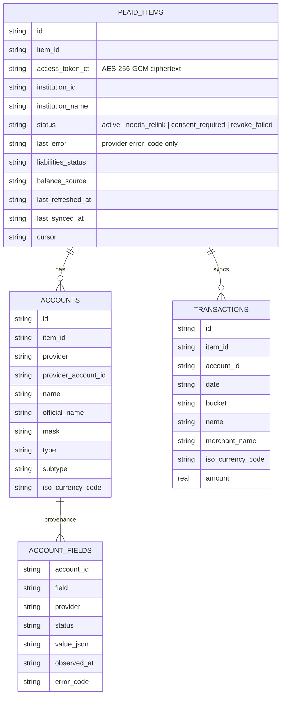
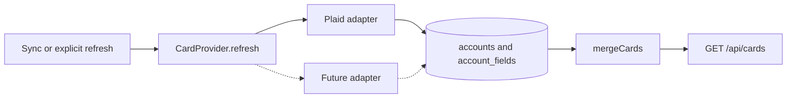
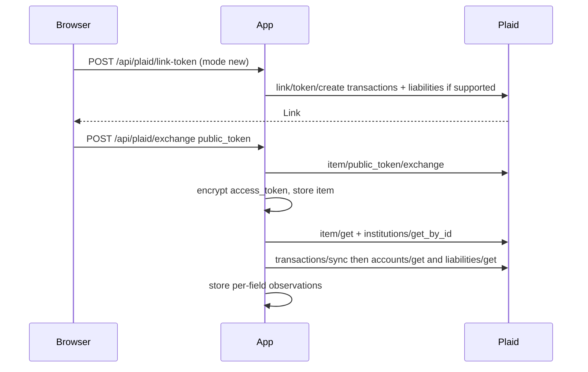
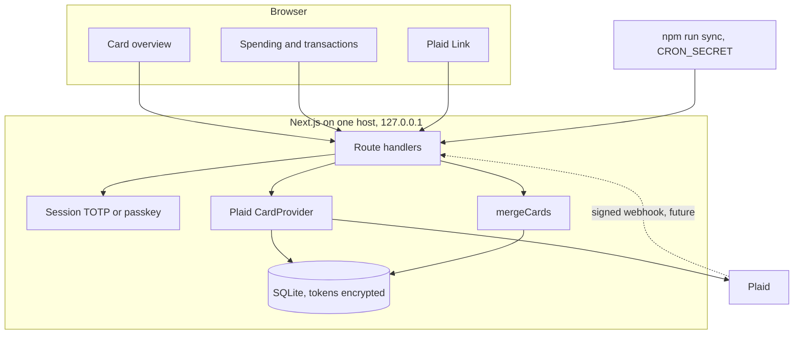

# AmexLens architecture

> **Status (reconciled 2026-10-31, WP8).** Design written Oct 30 2026; implemented across PRs #5 to #23 on the `wp*` branch chain (`HANDOVER.md` sections 3 and 12); vendor facts verified 2026-10-30 against Plaid docs; the Canadian institution table in `data-providers.md` reflects Plaid's 2026-10-16 coverage CSV and `npm run verify:sandbox -- --coverage` re-checks it. Everything here describes the built system unless it is marked **future**. Not built: reminders (ntfy/email), the webhook route, a Yodlee adapter, SQLCipher / column encryption of financial values. Nothing has been run against a real Plaid environment yet (`HANDOVER.md` section 4).

Single-user credit-card overview on top of the Next.js 15 spending dashboard. Transactions, categorization, and the monthly trend stay (at `/spending` and `/transactions`). The home screen is the card overview.

Provider research and the primary/fallback decision live in [data-providers.md](./data-providers.md). This file is the system design. The threat model, the findings, and the acceptance checklist are in [SECURITY.md](./SECURITY.md), and the attacker pass is [RED-TEAM.md](./RED-TEAM.md). The Security section below summarises what the code implements; SECURITY.md wins where they differ.

## 1. Providers

**Primary: Plaid.** Transactions for the spending pages. Liabilities for statement balance, minimum payment, due date, last payment, APR, and overdue. Balance for current balance, available credit, and limit: the free, cached `/accounts/get` on every sync, and the billed live `/accounts/balance/get` only when the owner presses "Refresh balance" on a card. Sandbox works with `user_good` / `pass_good`. An individual developer can use Plaid Trial (US/CA, signups on or after 15 April 2026, up to 10 production Items, includes Liabilities) before paying for full Production; the Item cap is lifetime, so deleting an Item does not free a slot.

**Fallback, interface only (future): Yodlee.** Same liability fields, Canada listed in FastLink, enterprise contract. `mergeCards` already prefers a present value from a lower-priority provider when Plaid's status is `not_supplied`, `not_supported`, `consent_required`, or `error`. The registry (`lib/providers/index.ts`) returns the Plaid adapter only and no Yodlee calls exist. Wiring a client that cannot be sandbox-tested would be a stub, so it is not shipped.

**Explicitly not the fallback for these fields: Flinks.** Better Canadian login coverage, and it returns current / available / limit, but it does not publish the liability fields. MX has a complete account schema and a thin public Canadian institution list. Finicity's schema is excellent and the product is not offered in Canada. Akoya is a US FDX network. Wealthica is investments. Inverite is lender verification. Detail and the institution table are in the provider doc.

Plaid institution flags are eligibility, not a promise that APR or the due date is non-null. The overview prints the status of each field.

## 2. Data model

Logical model. SQLite tables are the physical model. `plaid_items` stays the connection row because `transactions.item_id` references `plaid_items.item_id`; renaming it would be a risky migration for no query benefit. The provider discriminator is `accounts.provider` (`plaid` today) and `account_fields.provider`.



Connections are Plaid Items. Accounts are provider accounts of type `credit` (credit cards and PayPal credit, which Plaid returns on the liabilities `credit` array). Loans, mortgages, and deposit accounts are not cards. Their transactions still sync.

Each card field is its own observation (11 keys, `lib/providers/types.ts`):

| Field key | Meaning |
|---|---|
| `current_balance` | Amount owed. Positive means the cardholder owes it (Plaid's credit-account sign). |
| `available_credit` | Issuer available credit. Not computed from limit minus balance. |
| `credit_limit` | Issuer limit. |
| `statement_balance` | Last statement balance. "Due this cycle" totals use this, not the minimum. |
| `minimum_payment` | Minimum due. |
| `next_payment_due_date` | `YYYY-MM-DD`. |
| `last_payment_amount` | Last payment amount. |
| `last_payment_date` | `YYYY-MM-DD`. |
| `last_statement_issue_date` | `YYYY-MM-DD`. Returned by the SDK; omitted from Plaid's public docs page. |
| `is_overdue` | Boolean from the provider. `false` is a real value, not a missing one. |
| `apr` | Array of `{ apr_percentage, apr_type, balance_subject_to_apr, interest_charge_amount }`. `apr_type` is `purchase_apr`, `cash_apr`, `balance_transfer_apr`, `penalty_apr`, or `special`; an empty array is `not_supplied`. |

`status` is one of:

- `present` — value is from the provider
- `not_supplied` — the call succeeded and this field was null
- `not_supported` — the institution or product does not offer it
- `consent_required` — Plaid needs an update-mode Link session
- `error` — the call failed; `error_code` is a provider code, not a message body

`provider` and `observed_at` are the provenance. The API returns them. The UI uses them for the gap text ("Not supplied by Plaid", "Plaid does not support this field at this institution", "Reconnect Plaid to grant liabilities access", "Unavailable (Plaid error CODE)").

There is no manual-entry column and no write route for any of these values. Utilization is derived at read time and labeled computed.

Transactions and card values are stored in the clear in SQLite (`date`, `bucket`, `amount`, merchant, names, and `value_json` alike). Only the Plaid access token and the TOTP secret are column-encrypted. See Security.

Physical schema, by migration (`lib/db/migrations/`; ids are never renumbered):

| Id | File / step | Adds |
|---|---|---|
| 0001 | `0001_init.sql` | `plaid_items` (with the original plaintext token column), `transactions` |
| 0002 | `0002_core.sql` | `settings` (per-install Plaid `client_user_id`), `security_log` |
| 0003 | `0003_auth.sql` | `sessions`, `auth_state` (single row: TOTP secret ciphertext, last step, WebAuthn user handle), `passkeys`, `recovery_codes`, `auth_challenges` |
| 0004 | `token_ct` (code step in `index.ts`) | `access_token_ct`; encrypts existing tokens, drops the plaintext column, then `VACUUM` |
| 0005 | `0005_item_status.sql` | `plaid_items.status`, `last_error` |
| 0006 | `0006_card_liabilities.sql` | `accounts`, `account_fields`, `plaid_items.liabilities_status`, `balance_source`, `last_refreshed_at` |

## 3. Provider adapter and merge



```ts
interface CardProvider {
  id: ProviderId; // "plaid" | "yodlee" | "mx" | "flinks"
  refresh(
    secret: { access_token: string },
    opts: { realtimeBalance: boolean }
  ): Promise<ProviderRefresh>; // never throws on provider failures
}

interface ProviderRefresh {
  accounts_fetched: boolean;      // false means do not touch stored cards
  balance_source: "realtime" | "cached" | "error";
  liabilities_status: "ok" | "not_supported" | "consent_required" | "pending" | "error";
  error_code: string | null;
  cards: ProviderCard[];          // empty if the account list could not be fetched
}
```

The Plaid adapter (`lib/providers/plaid.ts`, field pickers in `lib/providers/plaid-fields.ts`):

1. Gets accounts from `/accounts/get` (free, cached). Only when `realtimeBalance` is set does it call `/accounts/balance/get` first; if that fails it falls back to `/accounts/get` and reports `balance_source: "cached"`. If both fail it reports `error` and the caller leaves stored cards untouched.
2. Keeps accounts with `type === "credit"`.
3. Calls `/liabilities/get` for those account ids. Maps `error_code` to `liabilities_status` (`ADDITIONAL_CONSENT_REQUIRED` is `INVALID_INPUT` 400 at Plaid; `PRODUCTS_NOT_SUPPORTED` and `NO_LIABILITY_ACCOUNTS` are `not_supported`; `PRODUCT_NOT_READY` is `error`). Does not throw out of the transaction sync.
4. Emits one observation per field through explicit pickers that never spread a response, so an `numbers` object, owners, or a full account number cannot reach SQLite. Nulls become `not_supplied` when the call worked, or the call's failure status when it did not.

`lib/cards/refresh.ts` stores the result (`upsertAccounts`, `replaceAccountFields`) and is called from `syncItem` inside the per-item lock, in its own try/catch, so a liabilities failure never rolls back new transactions. A refresh replaces every stored observation for the item: a transient `/liabilities/get` failure turns previously `present` liability values into `error` observations until the next success (SECURITY.md section 8).

Merge runs on read, not on write (`lib/cards/merge.ts`). Stored rows stay per provider account. `mergeCards` groups by a reconciliation key:

`normalize(institution name) + ":" + last 4 of mask + ":" + currency`

If both institution and mask are missing, the key is the provider account id so unrelated cards are not glued together.

For each field in a group, a `present` value wins. Among present values, provider priority wins (`plaid`, then `yodlee`, then `mx`, then `flinks`). If nobody has a present value, the highest-priority observation is kept so the UI can show why. A second provider's `not_supported` must not hide Plaid's `not_supplied`, and Plaid's `not_supported` must not hide another provider's real number. The priority rule does that.

`lib/cards/view.ts` builds the `GET /api/cards` response (per-currency totals, utilization with an excluded count, urgency, Toronto `today`). A later adapter is appended to the registry when its credentials exist; it writes its own `accounts` / `account_fields` rows and the read path merges them (**future**).

## 4. Connection, tokens, refresh



New items (`mode: "new"`): `products: ["transactions"]`, `required_if_supported_products: ["liabilities"]`, `account_filters: { credit: { account_subtypes: ["credit card"] } }`, `country_codes` from `PLAID_COUNTRY_CODES` (default `CA`; add `US` explicitly for a US-issued card), a per-install random `client_user_id`, and `redirect_uri` only if `PLAID_REDIRECT_URI` is set (it must be on `APP_ORIGIN`). No `webhook`. Balance is not placed in `products`; Plaid rejects that. Auth, Identity, Investments, and Statements are not requested, and `assertLeastPrivilege()` stops the server at boot if any list widens (`lib/plaid.ts`).

Existing items that predate Liabilities (`mode: "consent"`): Settings calls `POST /api/plaid/link-token { mode: "consent", item_id }`. The server loads the stored access token and opens Link in update mode with `additional_consented_products: ["liabilities"]` and no `products` array. On success the browser calls `POST /api/plaid/consent { item_id }`; the client never sends an access token. The server re-reads liabilities once from the free cached endpoints.

An expired login (`mode: "repair"`): update mode with the access token alone; the finish step is `POST /api/plaid/repair { item_id }`, which clears the flag and runs one sync.

OAuth (US institutions; whether a given Canadian institution uses OAuth is probed, not assumed, see data-providers.md): the link token is kept in `sessionStorage` under `amexlens_plaid_link` so `/plaid/oauth` can resume with `receivedRedirectUri`. The token is cleared after success. It is not put in the query string.

Item status (`plaid_items.status`, shown on Settings): `ITEM_LOGIN_REQUIRED` and `INVALID_ACCESS_TOKEN` set `needs_relink`; `ADDITIONAL_CONSENT_REQUIRED` sets `consent_required`; a disconnect that Plaid did not confirm sets `revoke_failed`. Update mode without extra products is the repair path; the same button flow requests liabilities consent when status is `consent_required`. (The webhook codes `PENDING_EXPIRATION` and `USER_PERMISSION_REVOKED` would set the same statuses once a webhook exists: **future**.)

Token storage: the Plaid access token is AES-256-GCM ciphertext in `plaid_items.access_token_ct` (`v1.<iv>.<tag>.<ciphertext>`, AAD `plaid_items:<item_id>`). The database layer decrypts it inside the server process. It is not returned by any API. Public tokens and link tokens are not stored. A row that no longer decrypts raises `TokenUnreadableError`, the card shows as needing a re-link, and the log carries the item id only.

Sync triggers (pull-only):

- Cron: `npm run sync` posts `POST /api/plaid/sync` on loopback with `Authorization: Bearer $CRON_SECRET`. A homelab or Tailscale deploy often has no public HTTPS endpoint, which is why pull-only is the default.
- The Sync buttons on Settings (a browser session plus the CSRF header).
- The first sync right after linking.
- **Future: `POST /api/plaid/webhook`.** Not implemented, and `middleware.ts` has no exemption for it. The design is kept: set `PLAID_WEBHOOK_URL` on the link token; the route verifies the `Plaid-Verification` JWT (ES256, key from `/webhook_verification_key/get`, `iat` within 5 minutes, SHA-256 of the raw body compared in constant time to `request_body_sha256`) before it reads the JSON; failed verification is 401 and does no work; verified `SYNC_UPDATES_AVAILABLE`, `DEFAULT_UPDATE`, `INITIAL_UPDATE`, `HISTORICAL_UPDATE`, and `PRODUCT_READY` refresh that item; `ITEM_LOGIN_REQUIRED`, `PENDING_EXPIRATION`, and `USER_PERMISSION_REVOKED` only update status. The route would sit outside the session check and be protected by the signature instead (SECURITY.md 3.4).

Refresh cadence and limits (Plaid's published defaults, which they can change):

| Endpoint | Per Item | Per client |
|---|---|---|
| `/accounts/balance/get` | 5 / minute, 30 / hour | 1,200 / minute |
| `/accounts/get` | 15 / minute | 15,000 / minute |
| `/liabilities/get` | 30 / minute | 10,000 / minute |
| `/transactions/sync` | 50 / minute | 2,500 / minute |

Balance policy. Liabilities data at Plaid refreshes about once a day, so cron should run once or twice a day, not in a tight loop; manual sync is limited to 6 per hour. One sync of one item is a transactions cursor loop plus one free `/accounts/get` plus one `/liabilities/get`; **sync never makes the billed balance call**. `/accounts/balance/get` (billed per successful call) is made only by `POST /api/cards/{id}/refresh`, limited to one call per card per 10 minutes, which falls back to the cached call on failure and says which source it used. That keeps billing proportional to clicks and far under the hourly Balance cap.

Transaction sync and card refresh are separate. A liabilities failure does not roll back new transactions. The sync response carries counts and provider status codes, not balances and not tokens. Each page of transactions is applied in its own DB transaction, the Plaid call is never inside one, and the cursor is written after the loop by compare-and-set against the cursor the sync started from.

## 5. Overview and reminders

Home (`/`) is the overview, sorted by urgency and then by due date. `/spending` is the previous dashboard (buckets, trend, recent transactions). `/transactions` and `/settings` are unchanged in purpose (Settings gained item actions, sign-in factors, the privacy panel and the danger zone).

Urgency uses the America/Toronto civil date (`lib/cards/urgency.ts`):

- `overdue` — `is_overdue` is true, or the due date is before today and the provider did not explicitly say `is_overdue: false`
- `due_soon` — due date is today through today+7, and not overdue
- `scheduled` — due date is later
- `past_not_overdue` — due date is in the past and the provider said not overdue (common on stale sandbox dates)
- `unknown` — no due date

Overdue cards sort first, then due-soon, then later dates, then unknown. The page banner counts overdue and due-within-7-days. Cards with a gap show the field status in words. Totals are per currency and are never added across CAD and USD:

- total balance: sum of present current balances
- total due this cycle: sum of present statement balances
- overall utilization: sum of current balances divided by sum of limits, only over cards where both values are present. Excluded cards are counted in the caption.

Notifications today are the banner plus one line from `npm run sync` (`overdue=` and `due_soon=` counts, no amounts). **Future:** a push or email channel (ntfy, SMTP). It should call the same urgency function and must not put account numbers or tokens in the message body.

## 6. Security

Threats this section is built for: a copied SQLite file, a stolen session cookie, a login brute-force, tokens or PAN-like data in logs, a wide Plaid consent, clickjacking, and an open redirect off `/login`. (A forged Plaid webhook becomes relevant only when the future webhook is built.) [SECURITY.md](./SECURITY.md) holds the full threat model, the per-finding status and the ticked acceptance checklist; [RED-TEAM.md](./RED-TEAM.md) holds the attacker pass.

### Encryption at rest

AES-256-GCM (`lib/crypto.ts`), random 96-bit IV per value, 128-bit tag, AAD bound to the row (`plaid_items:<item_id>`, `auth_state:totp`). Ciphertext is `v1.<iv>.<tag>.<ciphertext>`, base64url; the version selects a key from a key ring so a later rotation can add `v2`. Swapping a ciphertext into another row fails authentication. Decrypt failures do not fall back to plaintext.

Key: `TOKEN_ENCRYPTION_KEY` (32 bytes, base64) or `TOKEN_ENCRYPTION_KEY_FILE` (a `0600` file outside `data/`). The server refuses to start without a valid key and never generates one; `npm run key:generate` makes it. It is kept out of the database directory and out of backups, so a copied `data/` folder or a backup does not decrypt. `npm run backup` takes a consistent snapshot and encrypts it to an age public key (`BACKUP_AGE_RECIPIENT`); the age identity stays off the host. Losing the data key means re-linking; it does not make the file readable.

Encrypted: Plaid access tokens and the TOTP secret. **Not encrypted at the column level:** transactions (amounts, names, merchants), institution and card names and masks, and every `account_fields.value_json`. Full-disk encryption on the host, `0700`/`0600` file modes (set in code on open), and encrypted backups are therefore mandatory, and on a VPS a snapshot of the running disk exposes that text unless SQLCipher is added (**future**). Passkey public keys and recovery-code hashes are not secret.

Plaintext exists in process memory and on the wire to the logged-in browser. This is at-rest encryption, not end-to-end encryption. Serve the app over HTTPS.

Migration 0004 encrypts tokens that predate this change on the first start, drops the plaintext column and `VACUUM`s; old plaintext backups must be destroyed (`npm run backup -- --purge-plaintext`, `npm run verify:no-plaintext`).

### Authentication

`AUTH_MODE` has two values (`lib/auth/mode.ts`, `lib/env.ts`):

| Mode | Behavior |
|---|---|
| `required` (default) | Sign-in is a TOTP code, a passkey, or a recovery code. Factors are enrolled at runtime, not chosen by env. |
| `none` | No gate. Local sandbox and tests only. Refused at boot when `NODE_ENV=production` or `PLAID_ENV=production`. |

First run: `AUTH_SETUP_TOKEN` (at least 32 characters) is consulted only while zero factors are enrolled. The owner pastes it on `/login`, scans the TOTP QR, enters one code (the secret is stored encrypted and counts as enrolled only after that), and receives 10 single-use recovery codes (stored as SHA-256 hashes). A passkey (`@simplewebauthn/server`, user verification required, counter checked, RP ID and origin from `APP_ORIGIN`) can be added at setup or later from Settings; after the first factor every enrolment needs a session. TOTP is RFC 6238 (SHA-1, 6 digits, 30 seconds, window ±1) with the last accepted step persisted. There is no password and no `AUTH_PASSWORD`.

Sessions are server-side. The cookie `__Host-amexlens_session` holds a 256-bit random token; the `sessions` table stores only its SHA-256. Flags: `HttpOnly`, `Secure`, `SameSite=Lax` (so a bank OAuth redirect back to `/plaid/oauth` still has the session), `Path=/`. Absolute lifetime 12 hours, idle timeout 2 hours, rotated on sign-in and on link, disconnect and delete-all. Logout deletes the row, so a copied cookie dies with it; "Sign out everywhere" deletes every row. With `COOKIE_INSECURE_DEV=1` (plain-http LAN testing, refused when `PLAID_ENV=production`) the name is `amexlens_session` without `Secure`. The old literal-`ok` cookie is not token-shaped and is rejected.

Sign-in is locked for 15 minutes after 5 failures (`lib/auth/lockout.ts`). The counter is global and in memory because this is one user, per-IP limits can be skipped with a spoofed `X-Forwarded-For`, and the state resets on restart. The first consequence is that five bad codes from anywhere lock the owner out for 15 minutes; put a per-IP throttle at the reverse proxy.

`/login?from=` is accepted only when it is a same-app path (`^/[A-Za-z0-9/_-]*$`, not `//`, `lib/auth/from.ts`).

Every state-changing route also requires `Origin` (or `Referer`) to match `APP_ORIGIN` and the `X-AmexLens-Request: 1` header (`lib/auth/guard.ts`).

Cron cannot complete TOTP or a passkey. `CRON_SECRET` (at least 32 characters) is a bearer token accepted only on `POST /api/plaid/sync`, compared in constant time in the handler (`lib/sync/authorize.ts`). It is not accepted on other routes and not accepted in the query string. A presented bearer is never allowed to fall through to the session path.

API routes check the session themselves as the first statement of the handler (`requireSession` / `requireMutation` / `authorizeSync` / `authorizeSetup`). `middleware.ts` is the page gate (redirect to `/login`, built on `APP_ORIGIN`) and a 401-JSON gate for `/api/*`, and a second check, not the only check. The unauthenticated exceptions are `/api/health` (`{ok}` only), `/api/auth/*` (each with its own authenticator), the `/login` and `/plaid/oauth` pages, and static assets. There is no webhook route.

### Logs, headers, scopes

Logs and API errors carry provider `error_code` values and counts. They do not carry access tokens, public tokens, link tokens, secrets, TOTP secrets, recovery codes, or raw Plaid error payloads (`lib/log.ts` `redact()`, `lib/http/errors.ts`). `scripts/sync.mjs` prints counts. `scripts/verify-sandbox.mjs` prints which fields were present, not the values, and refuses to run unless `PLAID_ENV=sandbox`. `security_log` rows record sign-in, setup, link, revoke, refresh and delete-all events (not sync end, and unbounded; see SECURITY.md section 8).

Response headers on every route (`next.config.mjs` + `lib/security-headers.mjs`): `X-Content-Type-Options: nosniff`, `X-Frame-Options: DENY`, `Referrer-Policy: no-referrer`, `Permissions-Policy` with camera, microphone, geolocation, and payment disabled, `Cross-Origin-Opener-Policy: same-origin-allow-popups` (Plaid's OAuth window), `Cross-Origin-Resource-Policy: same-origin`, `X-Powered-By` disabled, `Cache-Control: no-store` on HTML and `/api/*`, no COEP. Pages get a Content-Security-Policy from `middleware.ts` with a fresh per-request nonce: `script-src 'self' 'nonce-<n>' https://cdn.plaid.com` (no `'unsafe-inline'`, no `'unsafe-eval'` outside `next dev`), `frame-src` locked to Plaid's CDN, `frame-ancestors 'none'`, `base-uri` and `form-action` `'self'`, `object-src 'none'`, `connect-src` limited to this origin and the Plaid API host. `'strict-dynamic'` is deliberately omitted (it would make browsers ignore the `cdn.plaid.com` allowlist). `upgrade-insecure-requests` follows the scheme of `APP_ORIGIN`. `/api/*` keeps a static nonce-less CSP. `Strict-Transport-Security` is set at runtime by middleware only when `ENABLE_HSTS=1`, so a first HTTP visit on a LAN does not pin the browser.

Least privilege for Plaid is in section 4 and in [data-providers.md](./data-providers.md). The app does not request Auth, Identity, Investments, Statements, or Transfer.

### Residual risk

The full list is [SECURITY.md section 8](./SECURITY.md#8-residual-risks-as-built). In short:

- `AUTH_MODE=none` is wide open (and refused in production).
- Anyone who can read the process, or who has both the SQLite file and the data key, can decrypt the tokens; the rest of the file is plaintext to anyone who can read it.
- In-memory lockout and rate limits reset on restart; a scope-only lockout is an availability lever.
- Recovery codes are unsalted SHA-256 of 50-bit codes.
- HTTPS, HSTS, and the host controls are operator settings.
- A second provider is not a security boundary. Its tokens would use the same encryption and the same "never log the token" rule.

## 7. Deployment and cost

Run it as a Node process next to the SQLite file, bound to `127.0.0.1` (`next start -H 127.0.0.1`) behind a TLS-terminating reverse proxy (Caddy or nginx) or on Tailscale. `better-sqlite3` is a native module, so Vercel-style serverless is the wrong host. A small VPS, a homelab box, or an always-on mini PC is enough. Do not publish the port with `AUTH_MODE=none`, and use a hostname origin if you want passkeys (WebAuthn refuses an IP-address RP ID).

| Piece | Cost |
|---|---|
| Host | Whatever you already pay. The app is one Node process and one SQLite file. |
| Plaid Sandbox | Free. |
| Plaid Trial | Free, up to 10 Production Items (lifetime cap), includes Transactions, Liabilities, and Balance. US/CA dashboard signups on or after 15 April 2026. |
| Plaid Production | Transactions and Liabilities: monthly subscription per Item. Balance: fee per successful `/accounts/balance/get`. The dashboard shows the dollars after you apply. A handful of cards, synced once or twice a day with a live balance refresh only on demand, is the intended bill. |
| Yodlee, Flinks, MX | Not used. Flinks Connect Starter is published at $500/month. That is not justified for the fields it returns. |
| Domain and TLS | For the reverse proxy and HSTS (and for a hostname passkey origin). A public endpoint would also be needed for the future webhook. Let's Encrypt is enough. |

`npm run backup` writes a timestamped, age-encrypted SQLite snapshot under `data/backups/` (newest 7 kept) and never touches the data key. Copy the key to a password manager separately. Restoring a backup without the key cannot decrypt tokens. Run `npm run restore:check` with the age identity (kept off the host) after setup and after upgrades.

`STORAGE=libsql` and `postgres` are still unimplemented. The `DB` interface is the seam.

## 8. Build phases

**Built (PRs #5 to #23)**

- Provider comparison and this design.
- Server-side sessions, TOTP, passkeys, recovery codes, CSRF, lockout; token encryption at rest, encrypted backups; security headers and nonce CSP; least-privilege Link tokens. (Webhook verification is **not** built; sync is pull-only.)
- Plaid cached-balance and liabilities refresh on sync, billed live balance on explicit refresh.
- `accounts` and `account_fields` with provenance.
- Home overview: due-date sort, 7-day and overdue highlighting, per-currency totals, utilization, gap labels.
- Update-mode consent and repair for items linked with Transactions only or with an expired login.
- Sandbox script `npm run verify:sandbox`.
- Delete-all-local-data, privacy panel, per-currency spending stats.
- Spending, transactions, and categorization left in place.
- Red-team pass and its e2e attacker suite.

**Next, only if a real issuer comes back unsupported (future)**

- Yodlee adapter behind `CardProvider`, writing the same field rows, merged on read.
- Confirm the specific institution in Yodlee's coverage before paying.

**Later (future)**

- ntfy or email reminders that reuse `dueUrgency` and omit amounts unless you opt in.
- Webhook URL on a real HTTPS host, with the verifier described in section 4 (SECURITY.md 3.4).
- SQLCipher and/or column encryption of transaction and liability values as a second at-rest layer. Token encryption stays either way.
- Deferred red-team items: passkey removal, audited forget-locally for undecryptable items, `security_log` retention, a Plaid client timeout, per-source secondary lockout.

## Owner checklist

Do these yourself. The repo does not contain keys. The longer, ordered version is `HANDOVER.md` section 9.

1. Create a Plaid account. Set `PLAID_CLIENT_ID` and the secret that matches `PLAID_ENV` (`sandbox`, then Trial or Production).
2. In the Plaid dashboard, enable Transactions, Liabilities, and Balance. Leave Auth, Identity, Investments, Transfer, and Signal off.
3. Leave `PLAID_COUNTRY_CODES` at its default `CA`; add `US` only for a US-issued card.
4. Sandbox smoke test: `user_good` / `pass_good` / MFA `1234` if asked, or `npm run verify:sandbox -- --with-liabilities --coverage ins_100533` with sandbox keys. The script creates a sandbox item, reads accounts and liabilities, prints field presence (never values), checks the coverage CSV flags, and removes the item.
5. For OAuth institutions, register the redirect URI in the Plaid dashboard and set `PLAID_REDIRECT_URI` to that exact URL (on `APP_ORIGIN`). Sandbox may use `http://localhost:3000/plaid/oauth`. Production must be HTTPS, with no query and no hash. Plaid's docs say Canadian institutions do not currently use OAuth; probe, do not assume.
6. Trial (real cards, free, 10 Items for life, includes Liabilities): Plaid dashboard, US/CA, signup on or after 15 April 2026. Full Production is a separate application. Read the price there before you leave Trial. Liabilities and Transactions bill per Item per month. Each live balance refresh bills a Balance request.
7. Set `AUTH_MODE=required` (the default), `APP_ORIGIN` (the exact browser origin, https in production) and a random `AUTH_SETUP_TOKEN`; complete the first-run setup on `/login` (TOTP, recovery codes, passkey) and then delete or rotate the setup token. Set `ENABLE_HSTS=1` and cookie security only behind HTTPS.
8. Generate `TOKEN_ENCRYPTION_KEY` with `npm run key:generate` and store it outside the database and its backups. The server will not start without it. Do not commit it.
9. For cron, set `CRON_SECRET` (at least 32 characters) and run `npm run sync` once or twice a day. More often wastes calls and can hit the 30-per-hour Item cap.
10. A webhook is not built; skip `PLAID_WEBHOOK_URL` (it is not read).
11. If a card shows liabilities as not supported (coverage file: Desjardins, PC Financial, Simplii, Vancity Visa, and others in the provider doc), decide whether that card is worth a Yodlee contract. Do not expect Flinks to supply the due date or the APR.
12. Run `npm test` and `npm run test:e2e` after pulling. Run `npm run verify:sandbox` when sandbox keys are in the environment.

## System diagram


